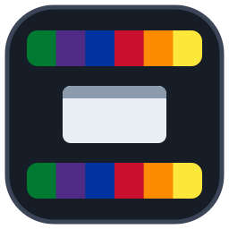

<p align="center"></p>

# ClassBanner

A classification banner for Windows 10 and 11. It keeps the system's marking (UNCLASSIFIED, CUI, CONFIDENTIAL,
SECRET, TOP SECRET, TOP SECRET//SCI) visible at the top and/or bottom of **every monitor**, at any resolution or
display scaling. It replaces the USAF *Banner 3.1* (2003); see [docs/banner-3.1-analysis.md](docs/banner-3.1-analysis.md).

- **One small file.** `ClassBanner.exe` is a native program (a few MB) with no .NET or other prerequisites. The same
  file installs, configures, uninstalls, runs the banner and is the screen saver.
- **Standalone or domain.** Configure with the command line on workgroup PCs, or with Group Policy (ADMX templates
  included) on domains. Group Policy always wins.
- **Stays on the right monitor.** Banners are rebuilt after unlock, resume, monitor changes, DPI changes and Explorer
  restarts, and are checked every 2 seconds. This fixes Banner 3.1's "second monitor's banners jump to the main
  screen after unlock" problem.
- **Can't simply be closed.** A small Windows service (*ClassBanner*, LocalSystem) starts the banner in every
  signed-in session and starts it again within seconds if it stops. Users can't end it with *End task*, and every
  unexpected stop is recorded in the Application event log.
- **Standard markings and colors**, with optional custom text such as `SECRET//NOFORN`.
- **Sign-in notice.** Optionally shows a message users must acknowledge before they can sign in.
- **In Control Panel.** *ClassBanner* appears in Control Panel (Appearance and Personalization, and System and
  Security) and in *Apps & features*. It opens a settings window with a live preview; settings enforced by Group
  Policy are shown locked.
- **Optional extras:** signed-in user name, clock (local or Zulu), classification-colored title bars and highlights, wallpaper, and a
  classification screen saver.

| Level | Banner | Text |
|---|---|---|
| UNCLASSIFIED | `#007A33` green | white |
| CUI | `#502B85` purple | white |
| CONFIDENTIAL | `#0033A0` blue | white |
| SECRET | `#C8102E` red | white |
| TOP SECRET | `#FF8C00` orange | black |
| TOP SECRET//SCI | `#FCE83A` yellow | black |

## Install

Download `ClassBanner.exe` from the [latest release](../../releases/latest) and check it against `SHA256SUMS.txt`:

```powershell
Get-FileHash .\ClassBanner.exe -Algorithm SHA256
```

### Standalone / workgroup PC

**Double-click `ClassBanner.exe`.** The setup window opens. Choose the classification and any options, click
**Install** and approve the Windows (UAC) prompt. ClassBanner is then installed for every user:

- **Start menu > ClassBanner** and **Control Panel > ClassBanner** open the same window to change settings later.
- It is listed in **Apps & features** (Programs and Features), where you can uninstall it.
- The *ClassBanner* service starts the banner now, for everyone signed in, and at every sign-in.

Running a newer `ClassBanner.exe` the same way offers **Upgrade** and keeps your settings.

#### Command line (scripts and deployment)

```bat
start /wait ClassBanner.exe install --level SECRET
```

More examples:

```bat
:: Custom marking, top banner only, Zulu clock
start /wait ClassBanner.exe install --level S --caption "SECRET//NOFORN" --position top --clock on --zulu

:: Sign-in notice users must click OK on before logging on
start /wait ClassBanner.exe config --logon-title "SECRET SYSTEM" --logon-text "This system is approved for SECRET. Authorized use only."

:: Any setting from the table below
start /wait ClassBanner.exe config --set FontSize=12 --set WallpaperMode=Generated

:: What is in effect, and where it came from
ClassBanner.exe show

:: Remove (add --keep-settings to keep settings.json)
start /wait ClassBanner.exe uninstall
```

**What uninstall puts back.** Before the banner first changes a user's title-bar/accent colors, wallpaper or screen
saver, it saves that user's own values (`HKCU\Software\ClassBanner\Saved`). `uninstall` restores them in every
profile on the computer: directly for users who are signed in, and by loading `NTUSER.DAT` for everyone else.
Profiles changed by 1.1.0 or earlier, which saved nothing, have the classification accent on title bars turned off, the
generated wallpaper removed and the ClassBanner screen saver switched off. Users who are signed in during the
uninstall see the change completely at their next sign-in. `uninstall --keep-user-settings` leaves profiles as they are.

**What uninstall leaves behind, on purpose:** each user's log, `%LOCALAPPDATA%\ClassBanner\ClassBanner.log` (and the
generated `wallpaper.bmp` next to it if that option was used), so the history is still there for troubleshooting or
audit; delete the folder if you don't need it. The *ClassBanner* event log source also stays registered so earlier
Application log entries remain readable.

Values can also be given as `--option=value`, e.g. `--logon-text="-- Authorized use only --"`.

> `install`, `config` and `uninstall` need administrator rights and ask for them (UAC) if needed, so *Uninstall* in
> *Apps & features* works for standard users with admin credentials.
>
> `start /wait` makes the prompt wait for the result; `ClassBanner.exe` is a windowed program so the banner never
> flashes a console window. Exit codes: `0` OK, `1` error, `2` bad arguments, `5` not run as administrator.

### Domain

1. Deploy `ClassBanner.exe install --quiet` (plus any options) as a computer startup script, or with
   SCCM/Intune/PDQ. (`--no-start` registers the service without starting it; it then starts at the next restart.)
2. Copy `ClassBanner.admx` and `en-US\ClassBanner.adml` (from `ClassBanner-<version>-GroupPolicy.zip`) to your
   Central Store (`\\<domain>\SYSVOL\<domain>\Policies\PolicyDefinitions`).
3. Set the policies under **Computer Configuration > Administrative Templates > ClassBanner**.

Banners pick up Group Policy changes after `gpupdate` (immediately) or within 30 seconds.

For the sign-in notice on domains, use the built-in policies **Computer Configuration > Windows Settings > Security
Settings > Local Policies > Security Options > Interactive logon: Message title / Message text for users attempting to
log on**.

### Unsigned program

Releases are not code-signed yet. Windows SmartScreen may warn the first time (choose *More info > Run anyway*), and
allow-listing tools (AppLocker, WDAC) need a rule for it. A hash rule using the published SHA-256, or a path rule for
`%ProgramFiles%\ClassBanner\*`, both work. The service and the banner are the same exe, so one rule covers both
(AppLocker doesn't apply to the service itself, which runs as LocalSystem; the banner runs as the signed-in user).

### Keeping the banner running

Since 1.2.0 the banner is started by the *ClassBanner* service (`ClassBanner.exe service`, automatic start,
LocalSystem) instead of the `Run` key:

- It starts the banner in each signed-in session (console and Remote Desktop) as that user, and starts it again
  about 2 seconds after it exits for any reason other than those below. If a banner keeps failing, it waits 30 seconds
  between attempts after the fifth restart in a minute.
- The banner process, its threads and everything else it creates are owned by SYSTEM (or limited by an Owner Rights
  entry), and its user may only query them. So *End task*, `taskkill` and suspending or ending its threads fail for
  the user (and for an administrator who isn't elevated). An elevated administrator can still end it; it's then
  restarted.
- Its health is watched too, not only whether it runs: a banner window that is hidden or minimized is shown again
  within 2 seconds; if the banner's window thread is suspended the service resumes it, and if that thread has ended
  the service ends the process and starts a new banner.
- Not restarted: *Exit* on the banner menu when `AllowUserExit` is on (until that user's next sign-in, or until an
  administrator turns `AllowUserExit` off), sign-out, `uninstall`, and the brief stop while `install` upgrades it.
- Standard users can't stop or reconfigure the service; only administrators can (and only they can install).
- Application event log, source **ClassBanner**: 1000 banner started (user, session), 1001 banner stopped
  unexpectedly and was restarted (user, session, exit code), 1002 user chose Exit, 1003 banner could not be started,
  1004 service error, 1005 banner frozen or showing nothing (resumed, or ended and restarted). The source stays registered after uninstall so earlier entries remain readable.

## Settings

Settings come from built-in defaults, then `settings.json`, then Group Policy
(`HKLM\SOFTWARE\Policies\ClassBanner`). Each value is checked on its own: an invalid value is skipped and logged
(and shown by `ClassBanner.exe show`) without affecting the others. `settings.json` accepts the same spellings as the
command line, e.g. `"Level": "S"`.

If no valid classification level is configured at all (no settings, an unreadable `settings.json`, or an invalid
`Level`), the banner shows a grey **CLASSIFICATION NOT SET - CONTACT YOUR ADMINISTRATOR** rather than defaulting to a
marking nobody chose. Nothing saves a level nobody chose either: `install` and `config` refuse to save settings
without a level (unless Group Policy sets it), and refuse to overwrite a `settings.json` they can't read. Numbers
outside the ranges below are rejected.

**Upgrading from Better Banner** (the name up to 1.2): run `ClassBanner.exe` and click **Install** (or
`ClassBanner.exe install`). It imports the settings from `%ProgramFiles%\BetterBanner` (or 1.0.0-beta.1's
`C:\ProgramData\BetterBanner`), keeps the sign-in notice and each user's saved colors, stops Better Banner's banners and
service, and removes Better Banner. Existing Group Policy (`HKLM\SOFTWARE\Policies\BetterBanner`) keeps applying until
you deploy the ClassBanner templates; then remove the old ones. Earlier Application log entries stay under the source
*Better Banner*; new ones use *ClassBanner*.

| Setting | Default | Description |
|---|---|---|
| `Level` | `Unclassified` | `Unclassified`, `Cui`, `Confidential`, `Secret`, `TopSecret`, `TopSecretSci` (also accepts `U`, `C`, `S`, `TS`, `TS/SCI`) |
| `Caption` | *(standard)* | Custom banner text, e.g. `SECRET//NOFORN`. Must be the level's marking or start with it followed by `//` or a space; anything else is refused by `install`/`config`/the settings window, and ignored with a warning (standard marking shown) when it comes from `settings.json` or Group Policy |
| `BackColor`, `ForeColor` | *(standard)* | `#RRGGBB` overrides. Colors other than the level's standard ones are applied, with a warning in `show` and the log |
| `Position` | `Both` | `Top`, `Bottom`, `Both` |
| `FontSize` | `10` | Points, 8-36. Scaled per monitor for display scaling |
| `BannerThickness` | `15` | Banner height in pixels at 100% scaling (12-120), scaled per monitor; `0` sizes it to fit the text. Text shrinks to fit a thin banner |
| `HoverTransparency` | `40` | Percent see-through while the mouse is over the banner (0-90) |
| `StayAboveFullScreenApps` | `true` | Keep the banner over full-screen presentations and video |
| `AllowUserExit` | `false` | Adds *Exit* to the banner's menu; the banner then stays closed for that user until they sign in again |
| `ShowUserName` | `false` | Show the signed-in user's account name on the left. It and the clock are hidden before the marking is ever shortened |
| `ClockEnabled` | `false` | Show a clock on the right |
| `ClockFormat` | `ddd dd-MMM-yy HH:mm%TZI%` | [.NET date format](https://learn.microsoft.com/dotnet/standard/base-types/custom-date-and-time-format-strings); `%TZI%` becomes `Z` or `L` |
| `ClockUseZulu` | `false` | Show UTC |
| `ClockUppercase` | `false` | e.g. `071830Z OCT 26` with format `ddHHmm%TZI% MMM yy` |
| `EnforceColors` | `true` | Classification-colored title bars, accent and selection highlight |
| `WallpaperMode` | `Off` | `Off`, `Generated` (solid color with the marking), `Image` |
| `WallpaperImagePath` | | Image for `WallpaperMode=Image` |
| `EnforceScreenSaver` | `false` | Use the classification screen saver |
| `ScreenSaverTimeoutSeconds` | `600` | 60-7200 |
| `ScreenSaverRequirePassword` | `true` | Lock when the screen saver ends |
| `LogonNoticeTitle`, `LogonNoticeText` | | Sign-in notice (applied by `install`/`config`) |

## Using the banner

- **Double-click** a banner to bring back windows whose title bar is hidden under it or off-screen.
- **Right-click** for *Recover hidden windows*, *Settings...* and *About* (which shows the marking and where
  settings came from).
- Hover over a banner to see through it.
- Log: `%LOCALAPPDATA%\ClassBanner\ClassBanner.log` (the service logs to
  `C:\Windows\System32\config\systemprofile\AppData\Local\ClassBanner\ClassBanner.log`).

## Development

Requirements: .NET 8 SDK. The core logic (settings, layout, reconciliation, clock, command line) is platform
independent and unit tested; the app is plain Win32 and compiles to a native exe with Native AOT.

```sh
dotnet build                 # builds everywhere (Linux/macOS only compile-check the Windows app)
dotnet test                  # unit tests, including the Group Policy template checks
dotnet publish src/ClassBanner -c Release -o publish   # native exe; Windows only
```

```
src/ClassBanner.Core   settings, markings, monitor layout and reconciliation, clock, command line (tested)
src/ClassBanner        Win32 app: banner windows, app-bar docking, policies, screen saver, installer
tests/                  xUnit tests
policy/                 Group Policy ADMX/ADML templates
scripts/smoke-test.ps1  end-to-end install/run/uninstall test used by CI
assets/                 logo (SVG/PNG); tools/icon/make_icon.py regenerates it and the app icon
```

### CI and releases

- **CI** (`.github/workflows/ci.yml`) runs on every push to `main` and every pull request, on Windows: build, unit
  tests, publish the native exe, then an end-to-end smoke test. The test installs the exe, checks files, registry and
  settings, runs the banner, checks only one copy can run, then uninstalls and checks cleanup. The exe is uploaded as
  a build artifact.
- **Releases**: update `CHANGELOG.md`, then either open **Actions > Release > Run workflow** and enter a version
  (e.g. `1.0.0`), or tag and push:

  ```sh
  git tag v1.0.0 && git push origin v1.0.0
  ```

  `.github/workflows/release.yml` builds and tests that tag, then publishes a GitHub Release with
  `ClassBanner.exe`, the Group Policy templates zip and `SHA256SUMS.txt`. Tags with a suffix (e.g. `v1.1.0-rc.1`)
  become pre-releases.
- Dependabot keeps NuGet packages and GitHub Actions up to date.

## License

Copyright © Austin Case. All rights reserved.
